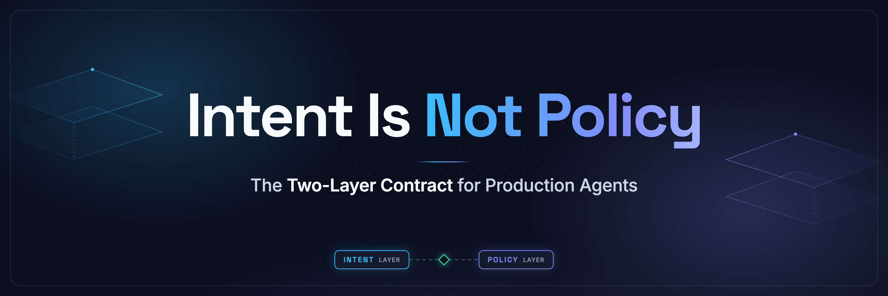

<p align="center">
  
</p>

<p align="center">
  <strong>Guidance influences what an agent does. Enforcement determines what it can execute.</strong><br>
  These are separate mechanisms. This repo proves it.
</p>

<p align="center">
  <a href="./LICENSE"></a>
  <a href="https://github.com/Darshitpandya/two-layer-agent-contract/releases"></a>
  <a href="https://github.com/agentgateway/agentgateway/releases/tag/v1.5.0"></a>
  <a href="https://modelcontextprotocol.io"></a>
  <a href="#contract-tests"></a>
  <a href="https://www.agenticengineering.day/speakers/darshit-pandya"></a>
</p>

<p align="center">
  <a href="https://x.com/darshitpandya_"></a>
  <a href="https://linkedin.com/in/darshitpandya"></a>
  <a href="https://platformpioneer.io"></a>
</p>

---

## The problem

A repository says:

```
Deployment work targets staging.
```

The runtime exposes:

```
deploy(environment)
  ├─ staging
  └─ production
```

One instruction. Broader authority than it describes. No model failure required — the architecture already contains it.

**Guidance shapes intent. Enforcement determines what executes. These need to be two separate, independently tested mechanisms.**

---

## Quickstart

**Prerequisites:** Docker Desktop · `make` · Node.js 22+

```bash
git clone https://github.com/Darshitpandya/two-layer-agent-contract.git
cd two-layer-agent-contract
make up
make session
make show-visibility
```

---

## How it works

Three containers. One enforcement boundary.

```
AGENTS.md  →  Agent decision  →  agentgateway  →  MCP server
 (intent)      (candidate)        (enforcement)    (capability)
```


*Diagram by [Archify](https://github.com/tt-a1i/archify)*

| Layer | Component | What it does |
|---|---|---|
| Guidance | `AGENTS.md` | Shapes agent intent — commands, conventions, preferred behaviour |
| Enforcement | `agentgateway` | Filters discovery surface, authorizes every tool call |
| Enforcement | `ExtMCP policy` | Argument-sensitive rules — same tool, different outcome |

---

## See the contract in action

```bash
make show-visibility    # without vs through agentgateway — 3 tools → 2 visible
make show-allow         # deploy(staging)    → ALLOW
make show-deny          # deploy(production) → DENY  — same tool, different authority
make show-hidden-denied # production_admin direct call → DENY
make show-backend-log   # backend receipt — only allowed calls arrived
make show-fail-closed   # policy down → failClosed → nothing forwards
```

---

## Use this pattern in your production repo

> **→ Start here: [`ADOPTING.md`](ADOPTING.md)**

Four steps:

1. **Copy** `gateway/config.yaml` and `gateway/extmcp-policy/policy.ts` into your repo
2. **Update** tool names and argument rules to match your MCP server
3. **Wire** your identity provider (API key or OIDC)
4. **Run** the contract tests — prove the boundary holds

The lab, Docker Compose, and Makefile are for running this demo. `ADOPTING.md` tells you exactly what to take and what to leave behind.

---

## Contract tests

34 tests prove runtime behaviour — not model compliance.

| Suite | What it proves |
|---|---|
| `allowed.test.ts` | Staging deploy reaches the backend |
| `hidden.test.ts` | `production_admin` absent from agent discovery |
| `denied.test.ts` | Direct invocation rejected, backend non-receipt confirmed |
| `arg-sensitive.test.ts` | Same tool name, different argument, different outcome |
| `fail-closed.test.ts` | Policy unavailable → request not forwarded |

```bash
make verify    # full suite: topology + unit + contract + fail-closed
make test      # contract tests only (stack must be running)
```

---

## Scope

This pattern addresses one problem: **behavioural instructions should not carry authorization responsibility.**

It does not claim to solve:
- Model alignment or prompt injection
- Credential lifecycle or secrets management
- Host sandboxing or MCP server correctness
- Non-MCP paths to the same backend

---

## Built with

| Component | Version | |
|---|---|---|
| [agentgateway](https://agentgateway.dev) (AAIF project) | v1.5.0 | [MCP authz docs](https://agentgateway.dev/docs/standalone/latest/documentation/configuration/security/mcp-authz/) |
| [Model Context Protocol](https://modelcontextprotocol.io) (AAIF) | 2025-03-26 | [Spec](https://modelcontextprotocol.io/specification/2025-03-26) |
| MCP SDK | @modelcontextprotocol/sdk@1.10.2 | [npm](https://www.npmjs.com/package/@modelcontextprotocol/sdk) |
| Node.js | 22+ | [nodejs.org](https://nodejs.org) |

> **AAIF** — [Agentic AI Foundation](https://www.solo.io/blog/agentgateway-joins-aaif-as-an-open-gateway-for-agentic-ai-infrastructure), a Linux Foundation directed fund governing open agentic AI infrastructure.

---

## Docs

| | |
|---|---|
| [`ADOPTING.md`](ADOPTING.md) | How to apply this pattern to your project or org |
| [`docs/architecture.md`](docs/architecture.md) | Two-layer contract diagrams |
| [`docs/contract-explained.md`](docs/contract-explained.md) | Pattern deep-dive |
| [`docs/production-hardening.md`](docs/production-hardening.md) | Production adaptation guide |

---

## Contributing · Security · License

[`CONTRIBUTING.md`](CONTRIBUTING.md) · [`SECURITY.md`](SECURITY.md) · Apache 2.0 [`LICENSE`](LICENSE)

---

<p align="center"><em>Intent is not policy. Context can remain flexible. Runtime authority must remain explicit.</em></p>
