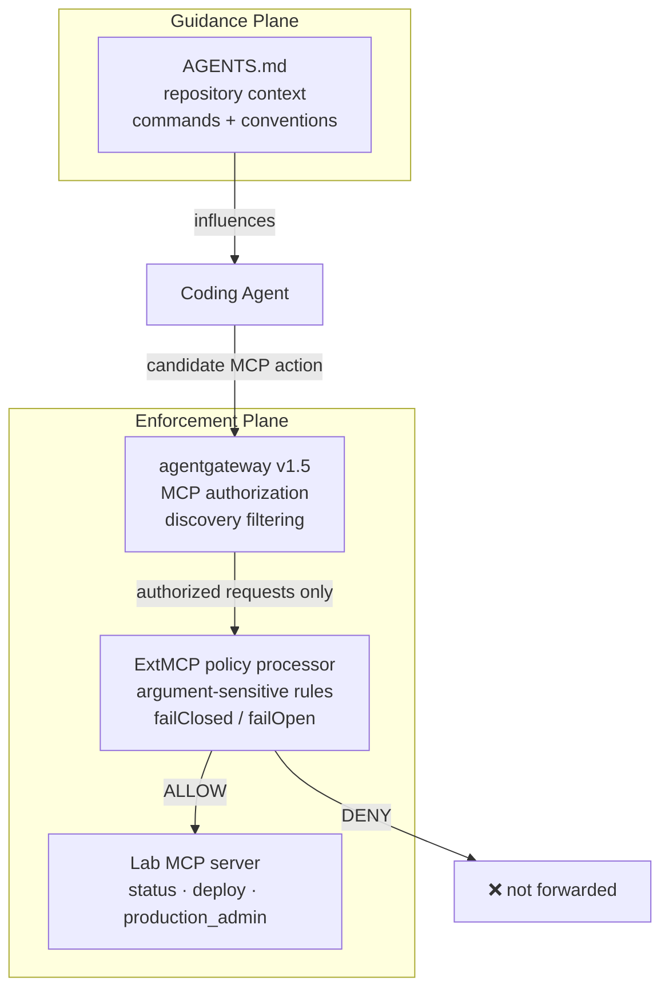
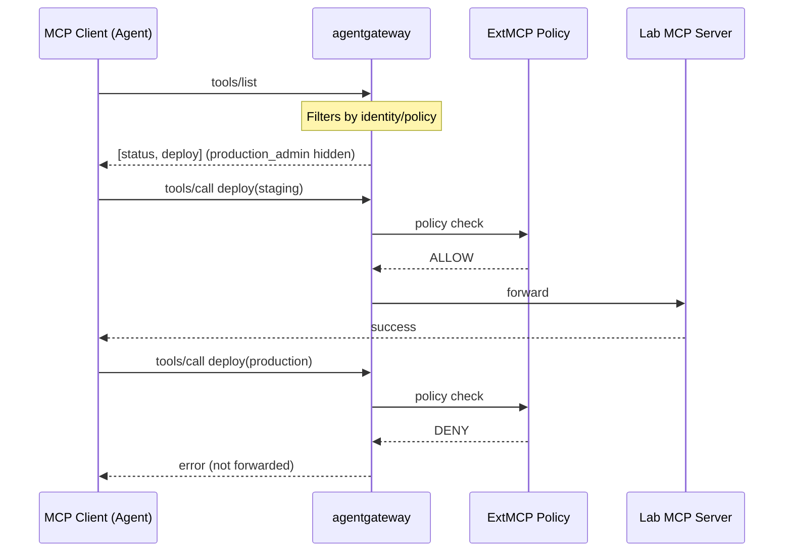
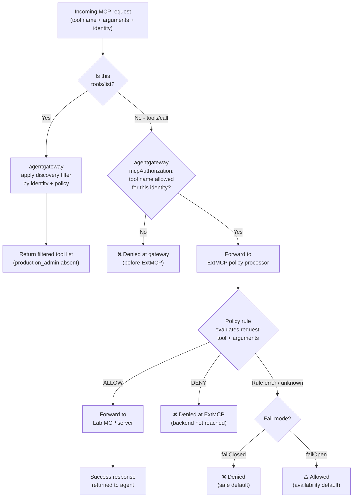

# Architecture: The Two-Layer Agent Contract

This document describes the architecture of the two-layer-agent-contract reference implementation and explains the design decisions behind each component. Three diagrams are provided: the overall contract structure, the MCP protocol boundary, and the enforcement decision flow.

---

## 1. The Two-Layer Agent Contract

### Why the two planes are separate

The guidance plane and the enforcement plane have different authors, different change rates, and different failure modes. AGENTS.md is written by the team that owns the repository. It is updated as the codebase evolves — new commands, changed conventions, updated environment names. It is committed alongside application code and reviewed as part of normal development.

The enforcement plane is configured by the team that owns the platform or security boundary. Changes to agentgateway policy are deliberate security decisions, not incidental updates to a documentation file. They require a separate review, a separate deployment, and a separate set of tests.

Keeping these planes separate means a developer updating AGENTS.md to reflect a new environment name cannot — even accidentally — grant the agent permission to act in that environment. The runtime authority is controlled independently.

If the planes were merged — if the same file controlled both what the agent was told and what it was permitted to do — then any edit to guidance would implicitly be an authorization change. That is the failure mode the Two-Layer Contract is designed to prevent.

### Why hidden is not the same as denied — and why both matter

When agentgateway filters `production_admin` from the tools/list response, the agent never learns the tool exists. This is **visibility control**. It reduces the surface area the agent reasons about, which reduces the likelihood of an attempted invocation. It is genuinely useful.

But hidden is not denied. A sufficiently capable or adversarially influenced agent could attempt to call `production_admin` directly without having seen it in discovery — either by guessing, by following injected instructions, or by remembering it from a previous session. If the only control is discovery filtering, that direct call would succeed.

**Denied** means the invocation is rejected at the policy layer regardless of how the request arrived. Hidden prevents the well-behaved path from reaching the tool. Denied prevents all paths from reaching the tool when the policy says no.

Both matter. Hidden reduces attack surface. Denied provides the backstop. A system with only hidden-but-not-denied gives the appearance of enforcement without the substance.

### Why argument-sensitive policy requires ExtMCP

agentgateway v1.5 `mcpAuthorization` operates at the tool-name level. It can allow or deny access to `deploy` as a whole. What it cannot do, at v1.5, is inspect the argument values in the call. The request `deploy(environment="staging")` and the request `deploy(environment="production")` look identical at the `mcpAuthorization` layer — both are calls to `deploy`.

This is a documented limitation. agentgateway issue #3092 describes a related case in Kubernetes mode v1.4.1 where a rule author expected to reference tool arguments in an `mcpAuthorization` rule, but the arguments were not available at that layer. The rule was accepted by the configuration parser but rejected a call the author intended to allow — a false negative that would not appear in a test suite that only checked negative cases.

ExtMCP is the correct place for argument-sensitive policy. The ExtMCP policy processor receives the full request, including argument values, before forwarding to the backend. A rule expressed there can distinguish `environment="staging"` from `environment="production"` deterministically.

The lab uses agentgateway mcpAuthorization for tool-level visibility and invocability, and ExtMCP for argument-sensitive allow/deny. The combination covers both dimensions of the enforcement plane.

### The independence test

> Changing AGENTS.md must not silently expand runtime authority.

This is the key invariant. To verify it, make a change to AGENTS.md — add a new environment, remove a restriction, change a convention — and then run the contract tests. If any negative test starts passing (forbidden access now succeeds) without a corresponding change to gateway or ExtMCP policy, the independence test has failed.

The contract tests in [`contract-tests/`](../contract-tests/) are designed to catch exactly this: they assert specific outcomes against the enforcement plane directly, not against what AGENTS.md says. A passing test suite after an AGENTS.md change is evidence that the two planes remain independent.

---

## 2. MCP Protocol Boundary

The MCP protocol treats tool discovery and tool invocation as distinct operations. The architecture takes advantage of this separation.

### tools/list and tools/call as separate enforcement moments

`tools/list` is the discovery request. The agent asks: what can I do? agentgateway intercepts this request and filters the response according to the identity and policy of the requesting client. In the lab, `production_admin` is removed from the list before the response reaches the agent. The backend MCP server serves all three tools; the filtering happens at the gateway.

`tools/call` is the invocation request. For each call, the gateway forwards to the ExtMCP policy processor before deciding whether to forward to the backend. ExtMCP inspects the full request — tool name and argument values — and returns ALLOW or DENY. A DENY at this point means the backend never sees the request. The agent receives an error response.

The two moments are independent. A tool can be hidden but invocable (if only discovery filtering is configured, not invocation policy). A tool can be visible but uninvocable (if it appears in the list but invocation is denied). In the lab, `production_admin` is both hidden and denied — defense in depth. `deploy` is visible and conditionally invocable depending on the `environment` argument.

### The staging success path

`deploy(environment="staging")` follows the full path: gateway → ExtMCP → ALLOW → backend → success response. This is the positive test. It exists to confirm that enforcement policy does not over-block. A policy that rejects everything is not a correct policy; it must allow the intended path through.

### The production rejection path

`deploy(environment="production")` is rejected at ExtMCP. The backend never receives this call. The agent receives an error. The authentic captured trace in the lab shows this rejection occurring in the ExtMCP policy evaluation step, before the gateway forwards to the backend.

This is the negative test. Both the staging success and the production rejection must be present in the test suite for the contract to be verified.

---

## 3. Enforcement Decision Flow

What happens at each policy point when a request arrives.

### What happens at each policy point

**agentgateway discovery filter (tools/list path)**  
Applies before the response is constructed. The backend's full tool list is retrieved, filtered by the identity and policy of the requesting client, and the filtered list is returned. This is where `production_admin` disappears from the agent's view.

**agentgateway mcpAuthorization (tools/call path)**  
Evaluates the tool name against the authorization rules for the requesting identity. If the tool is not authorized, the request is denied here before ExtMCP is consulted. This is the coarse-grained invocation gate.

**ExtMCP policy processor**  
Evaluates the full request — tool name and argument values — against the configured policy rules. This is where argument-sensitive decisions are made. `deploy` with `environment="staging"` is allowed; `deploy` with `environment="production"` is denied. The backend is only reached when ExtMCP returns ALLOW.

**Fail mode**  
When ExtMCP cannot evaluate a request — rule evaluation error, policy file missing, unexpected input — the configured fail mode determines the outcome. `failClosed` denies the request (safe default for security-sensitive paths). `failOpen` allows the request (availability default for paths where blocking is worse than allowing). The fail mode must be an explicit configuration choice, not an implicit default.

### Reading this flow in the lab

The contract tests exercise this flow directly. They do not go through the agent; they call the gateway as an MCP client and assert the outcomes. This means the tests verify the enforcement plane independently of what any instruction file says, and independently of model behaviour.

See [`contract-tests/`](../contract-tests/) for the test implementation and [`gateway/extmcp-policy/`](../gateway/extmcp-policy/) for the policy rules evaluated in the ExtMCP step.
