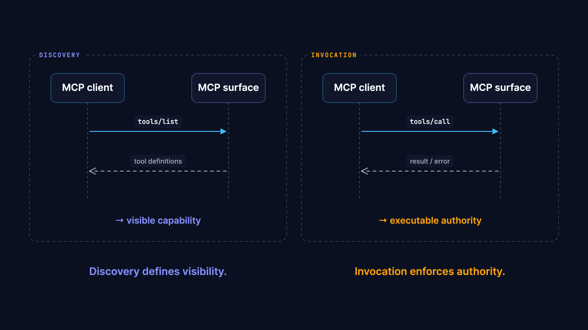
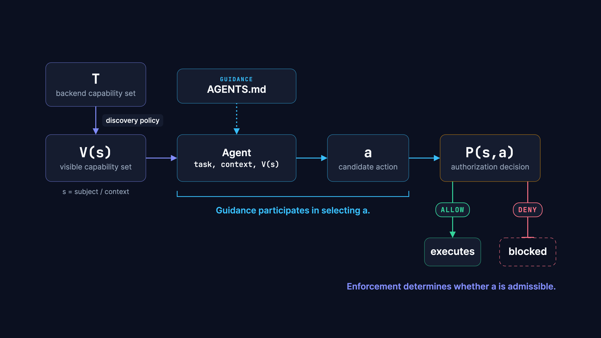
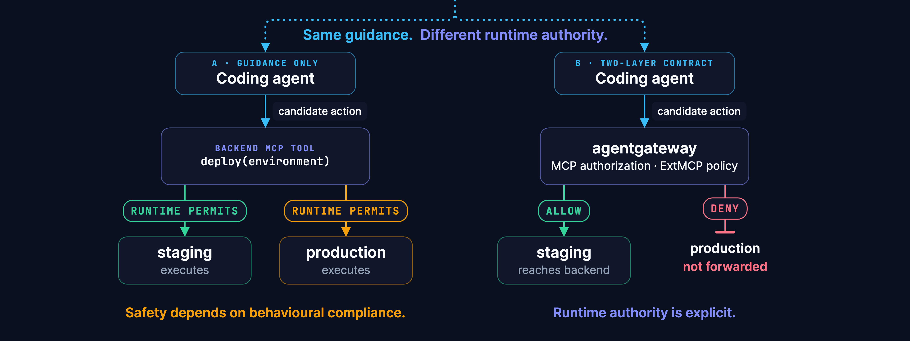

# Architecture: The Two-Layer Agent Contract

---

## 1. The Two-Layer Agent Contract

*Diagram by [Archify](https://github.com/tt-a1i/archify)*

The guidance plane contains repository-local context: `AGENTS.md`, commands, conventions, and operating guidance. That context participates in the agent's decision process.

The resulting candidate action crosses an MCP boundary into the enforcement plane. `agentgateway` constrains the effective MCP surface and evaluates authorization. The ExtMCP policy processor evaluates argument-sensitive rules before any request reaches the backend.

### Why the two planes are separate

The guidance plane and enforcement plane have different authors, different change rates, and different failure modes.

`AGENTS.md` is written by the team that owns the repository — updated as the codebase evolves, committed alongside application code. The enforcement plane is configured by the team that owns the platform or security boundary — changes are deliberate security decisions requiring separate review and deployment.

Keeping these planes separate means a developer updating `AGENTS.md` cannot — even accidentally — grant the agent permission to act in a new environment. The runtime authority is controlled independently.

**The key invariant:** changing `AGENTS.md` must not silently expand runtime authority.

---

## 2. MCP Protocol Boundary

*Diagram by [Archify](https://github.com/tt-a1i/archify)*

The MCP protocol treats discovery and invocation as distinct operations. The architecture takes advantage of this separation.

**`tools/list` — discovery**
agentgateway intercepts and filters the response by identity and policy. `production_admin` is removed before the response reaches the agent. The backend serves all three tools; filtering happens at the gateway.

**`tools/call` — invocation**
For each call, the gateway forwards to the ExtMCP policy processor before deciding whether to forward to the backend. ExtMCP inspects the full request — tool name and arguments — and returns ALLOW or DENY. A DENY means the backend never sees the request.

### Why hidden is not the same as denied

Discovery filtering reduces the surface area the agent reasons about. But a sufficiently capable or adversarially influenced agent could call `production_admin` directly without having seen it in discovery. If the only control is discovery filtering, that direct call would succeed.

**Hidden** prevents the well-behaved path. **Denied** blocks all paths. Both are required. Hidden reduces attack surface; denied provides the backstop.

---

## 3. Action Selection ≠ Action Admissibility

*Diagram by [Archify](https://github.com/tt-a1i/archify)*

Repository guidance participates upstream in selecting a candidate action. Enforcement evaluates whether that action is admissible. These are separate transitions — and that makes them independently testable.

### Why argument-sensitive policy requires ExtMCP

`mcpAuthorization` in agentgateway v1.5 operates at the tool-name level. `deploy(environment="staging")` and `deploy(environment="production")` look identical at that layer — both are calls to `deploy`.

ExtMCP receives the full request including argument values. A rule expressed there can distinguish `staging` from `production` deterministically. The lab uses `mcpAuthorization` for tool-level visibility and ExtMCP for argument-sensitive allow/deny — the two layers cover both dimensions of the enforcement plane.

---

## 4. Same Instruction. Different Architecture.

*Diagram by [Archify](https://github.com/tt-a1i/archify)*

The repository guidance has not changed. Only the runtime architecture changes.

**Architecture A** — guidance only: `production` remains executable. Safety depends on behavioural compliance.

**Architecture B** — two-layer contract: `staging` guidance still shapes behaviour, but the runtime independently denies `production`. Authority is explicit.

This is the independence test. Run the contract tests after any `AGENTS.md` change. If any negative test starts passing without a corresponding change to gateway or ExtMCP policy, the independence test has failed.

---

## Component reference

| Component | Role | Config |
|---|---|---|
| `AGENTS.md` | Guidance plane — shapes agent intent | Root and `agents/` |
| `agentgateway v1.5` | Enforcement — discovery filtering + call authz | `gateway/config.yaml` |
| `ExtMCP policy` | Enforcement — argument-sensitive allow/deny | `gateway/extmcp-policy/policy.ts` |
| Lab MCP server | Backend — status, deploy, production_admin | `mcp-server/src/` |

See [`gateway/README.md`](../gateway/README.md) for enforcement plane detail.
See [`ADOPTING.md`](../ADOPTING.md) to apply this pattern to your project.
