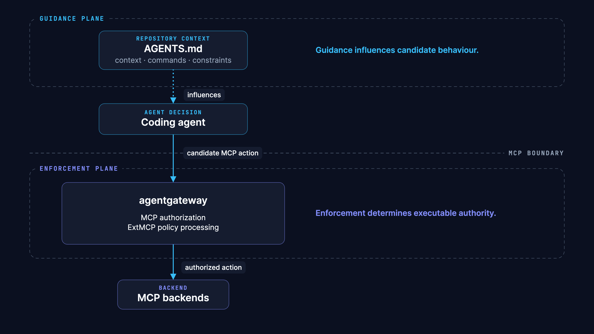

# The Two-Layer Agent Contract: A Deep Explanation

This document explains the Two-Layer Agent Contract for readers who want to understand the pattern fully — without the slides, without the live demo, with enough detail to apply it to their own systems.



*Diagram by [Archify](https://github.com/tt-a1i/archify)*

The short version: guidance influences what an agent proposes. Enforcement determines what an agent can execute. These are not the same contract, and they must not be implemented as the same mechanism.

---

## 1. The Problem: Instruction and Authority Are Not the Same Contract

When a team deploys a coding agent, they typically write an instructions file. This file says things like: "deploy to staging, not production", "use the blue-green deployment pipeline", "do not modify the infrastructure configuration directly". These are reasonable instructions. They are also text.

Text instructions work by influencing a language model's output. A model that reads "deploy to staging, not production" will, in the normal case, propose staging deployments. This is useful. It reduces the probability of unwanted proposals. But it does not make a production deployment impossible — it makes it less likely.

The gap between "less likely" and "impossible" is where production incidents live.

Consider what can narrow that gap from the instruction side: more detailed instructions, more examples, clearer scope definitions. These are good practices. They improve model behaviour and they should be done. But they operate on probability. They do not create a hard boundary.

Now consider what creates a hard boundary: a system that evaluates every action request against a deterministic policy before forwarding it to the backend, and rejects requests that do not satisfy the policy regardless of what the instruction file says. This is not a probability. It is a gate. The model cannot reason past it; it simply receives a rejection response.

The Two-Layer Agent Contract names these two mechanisms explicitly and keeps them separate:

- **Guidance plane**: influences candidate behaviour through repository context (AGENTS.md)
- **Enforcement plane**: determines executable authority through runtime policy (agentgateway + ExtMCP)

The problem is not that teams write instructions files. Instructions files are valuable. The problem is when the instructions file is the only mechanism — when "we told it not to" is the complete answer to "what stops it?".

---

## 2. The Two Planes and Their Distinct Responsibilities

### Guidance plane

The guidance plane lives in the repository. Its primary artifact is AGENTS.md — a file read by coding agents that provides repository-specific context the model would not otherwise have.

AGENTS.md should contain:
- Which commands to run for common operations
- Which environments exist and what they are for
- Which conventions the codebase follows
- What the agent should and should not propose

This file is useful precisely because it gives the agent accurate context about this specific repository. Without it, a general-purpose model will make plausible but wrong assumptions. With it, the model's proposals are more accurate, more targeted, and more likely to match what the team actually wants.

The guidance plane's responsibility is **reducing the frequency of unwanted proposals**.

What the guidance plane cannot do: prevent an unwanted action once a proposal becomes an invocation. At the point an MCP tool call is made, AGENTS.md is not in the loop. The enforcement plane is.

### Enforcement plane

The enforcement plane sits between the agent and the backend. In this architecture, it consists of two components:

**agentgateway** enforces at the tool level. It controls which tools appear in discovery responses (visibility) and which tool calls are permitted at all (invocability). These decisions are made per-identity and are independent of repository content. A change to AGENTS.md does not change what agentgateway will or will not forward.

**ExtMCP** enforces at the argument level. It evaluates the full request — tool name and argument values — against a policy ruleset before deciding whether to forward. This is where rules like "allow deploy when environment is staging, deny when environment is production" are expressed and enforced.

The enforcement plane's responsibility is **determining what actions are executable**.

These responsibilities are different in kind, not just degree. Reducing proposal frequency and determining executable authority are complementary but neither subsumes the other.

---

## 3. The Three Enforcement Properties

A complete enforcement plane provides three properties for any given tool call scenario.

### Visibility

Can the agent see the tool in discovery?

agentgateway filters the tools/list response before it reaches the agent. A tool that is not in the list is not visible to the agent. This reduces the reasoning surface — the agent cannot propose calling a tool it does not know exists.

Visibility control is valuable but not sufficient on its own. See the section on hidden vs. denied.

### Invocability

If the agent calls this tool by name, is the call permitted?

agentgateway mcpAuthorization evaluates tool-call requests against the authorization rules for the requesting identity. A call to a tool that is not authorized for this identity is denied before reaching ExtMCP or the backend.

This is coarse-grained: it operates on tool names, not argument values. It is the right place for rules like "this agent identity may not call production_admin under any circumstances".

### Argument-sensitivity

If the agent calls this tool with these specific arguments, is the call permitted?

ExtMCP evaluates the full request at invocation time. Rules can inspect argument values and make allow/deny decisions based on them. This is the right place for rules like "deploy is allowed when environment=staging, denied when environment=production".

Note: agentgateway v1.5 `mcpAuthorization` does not provide argument-sensitivity. Tool arguments are not available at that layer. This is documented in the v1.5 release notes and confirmed by agentgateway issue #3092, which describes a v1.4.1 case where a rule author expected to reference arguments in an authorization rule, found them unavailable, and produced a rule that rejected calls the author intended to allow.

A production system that needs argument-sensitive policy must implement it at ExtMCP (or equivalent) — not at the gateway authorization layer.

---

## 4. Why Deterministic Policy Matters

A deterministic policy produces the same result for the same input, every time. Given:
- The same request (tool name + arguments)
- The same requesting identity
- The same policy configuration

A deterministic policy returns the same decision. Always.

This matters for three reasons.

**Auditability.** A deterministic outcome can be explained: this request was denied because rule R matched condition C. A probabilistic outcome — "the model usually doesn't do this" — cannot be audited in the same way.

**Testability.** A deterministic policy can be tested with assertions. The contract tests in this repository call the gateway directly and assert specific outcomes. If the outcome changes without a policy change, the test fails. This is only possible because the policy is deterministic.

**Independence.** A deterministic policy decision is independent of model behaviour, prompt content, and conversation history. The agent cannot reason past it by being more persuasive, by trying a different phrasing, or by accumulating context that makes the action seem more justified. The policy sees the request, not the reasoning.

The enforcement plane in this architecture is deterministic. The guidance plane is not, and does not need to be — its purpose is to influence, not to gate.

---

## 5. What Fail-Closed Means and When to Use Each Mode

Every policy evaluation can encounter an error state: the policy file is malformed, the rule evaluation engine throws an exception, the request has an unexpected shape. When this happens, the policy processor must make a decision without a valid policy result.

**failClosed**: deny the request when policy evaluation fails.

This is the safe default for security-sensitive paths. If you cannot confirm the request is allowed, do not allow it. The cost is a false negative — a legitimate request is blocked — but the alternative is an unknown request proceeding to a backend that might execute a destructive action.

**failOpen**: allow the request when policy evaluation fails.

This is the availability default. Use it when the cost of blocking a legitimate request is higher than the cost of allowing an unknown request. This is appropriate for paths where the backend has its own authorization and the policy layer is an additional signal rather than the primary gate.

The fail mode must be an explicit configuration choice. There is no universally correct answer. But there is a wrong approach: not thinking about it and accepting whatever default the framework provides.

For paths that enforce the "must not reach production" requirement, use failClosed. An evaluation error should not open the gate; it should trigger an alert and block the request.

---

## 6. The Independence Test

> Changing AGENTS.md must not silently expand runtime authority.

This is the central invariant of the Two-Layer Contract. To test it:

1. Make any change to AGENTS.md — add a new environment name, remove a "do not" instruction, add a new tool mention.
2. Run the full contract test suite against the enforcement plane.
3. Verify that no negative tests now pass (no previously-forbidden action is now allowed).

If a negative test starts passing after an AGENTS.md change without a corresponding change to gateway or ExtMCP policy, the two planes are not independent. The enforcement plane is implicitly reading or reflecting guidance plane content.

In a correctly implemented Two-Layer Contract, the enforcement plane has no dependency on AGENTS.md. The gateway reads its own configuration. ExtMCP evaluates its own policy rules. Neither consults the repository instruction file at runtime.

This independence is what makes the contract trustworthy. If the enforcement plane depended on guidance plane content — if a gateway rule said "check AGENTS.md and apply its restrictions" — then every AGENTS.md commit would be an implicit policy change, unreviewed by the people responsible for security policy, untested by the contract test suite.

Run the independence test on every guidance plane change. Make it part of CI.

---

## 7. Extending to Non-MCP Paths — The Bypass Question

The enforcement plane in this architecture covers MCP tool calls. This is the right place to start for agent systems that use MCP as their action interface. But MCP is not the only path to a backend.

Consider a deployment backend that is reachable via:
- MCP tool call (covered by this architecture)
- Direct HTTP API call
- SSH command execution
- Shared filesystem write followed by a scheduled job

If the agent has access to any of these non-MCP paths, the MCP enforcement plane does not cover them. An agent that is blocked from `deploy(environment="production")` via MCP may still be able to trigger a production deployment via a direct API call if the API is accessible from the agent's runtime environment.

Ryan Dahl, in his AI Engineer talk on security firewalls for agents, frames this as the **bypass question**: for every enforcement boundary you draw, what are the paths that bypass it? The enforcement plane is only complete when the set of bypasses is empty — or when each bypass has its own enforcement boundary.

In practice, the bypass question means:
- Identify every path from the agent's runtime to each consequential backend.
- For each path, determine whether it is covered by the enforcement plane.
- For paths not covered by MCP authorization, apply equivalent controls: network policy, IAM, API gateway authorization, or OS-level sandboxing.

The Two-Layer Agent Contract does not solve the bypass question automatically. It gives you a pattern for one class of paths (MCP tool calls) and a vocabulary for asking the bypass question about the rest.

---

## 8. What This Pattern Does Not Solve

The Two-Layer Agent Contract addresses one specific problem: ensuring that runtime enforcement authority over MCP-accessible tools is independent of, and not silently expandable by, repository guidance.

It does not address:

**Model alignment.** Whether a model behaves as intended in general — follows instructions accurately, reasons correctly, does not hallucinate tool calls — is outside the scope of this pattern. The enforcement plane catches what alignment misses, but it does not substitute for alignment work.

**Prompt injection generally.** An attacker who can inject content into the agent's context can potentially influence the agent's proposals. The enforcement plane will block injected proposals that violate policy, but it does not prevent the injection from occurring or from influencing other agent behaviour.

**Credential lifecycle.** The secrets used to authenticate to the gateway and backend have their own lifecycle: issuance, rotation, expiry, revocation. This pattern does not manage credentials. Expired or revoked credentials will either cause unexpected access failures or, if not properly revoked, unexpected access grants.

**Host sandboxing.** The machine running the agent has filesystem access, network access, and process execution capabilities that are independent of MCP. Constraining what the agent can do at the host level — filesystem isolation, network egress filtering, process sandboxing — is outside the scope of this architecture.

**MCP server correctness.** The backend MCP server is assumed to implement its advertised tool semantics correctly. If the backend has its own bugs — a deploy tool that ignores the environment argument and always deploys to production, for example — the enforcement plane will pass or block calls correctly according to policy, but the backend's incorrect behaviour is not detected or corrected by this architecture.

These are real problems. Several of them are harder than the problem this pattern solves. Acknowledging what is out of scope is part of understanding what is in scope.

---

## Reusable Checklist

Use this to evaluate whether a given agent system implements the Two-Layer Agent Contract.

```
□ Repository-local context in AGENTS.md (guidance plane)
□ Effective MCP discovery surface is constrained (not all backend tools visible)
□ Invocation is authorized independently from discovery
□ Argument-sensitive operations have a policy point that sees request content
□ Fail mode is explicit and tested
□ Positive tests verify intended access succeeds
□ Negative tests verify forbidden access fails
□ Non-MCP paths to the same backend are bounded
```

Each item in this checklist is independently verifiable. "Effective MCP discovery surface is constrained" can be checked by making a tools/list call and inspecting the response. "Negative tests verify forbidden access fails" can be checked by running the test suite and reading the assertions.

A checklist item that cannot be verified is not done. "We think the policy is correct" does not satisfy "fail mode is explicit and tested". Run the test. Inspect the failure mode configuration. Then check the box.
